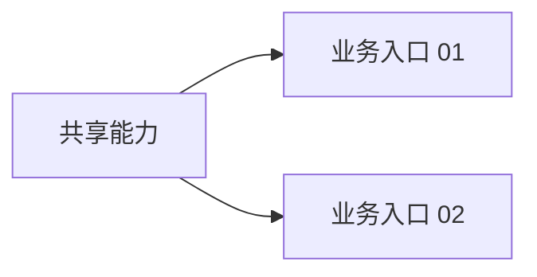
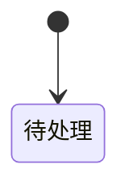
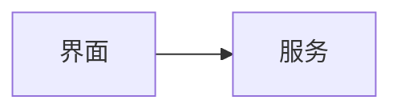

# 产物模板

> 原子技能的推荐产物模板。模板是结构约束，不是自动编排契约。

每个产物都必须包含文末 `Metadata`，日期格式为 `YYYY-MM-DD`。`Scope` 取 `requirement` 或 `module`；模块级产物必须填写 `Module`。

占位符约定：

- `{{requirement}}`：需求标识，如 `user-login-refactor`。
- `{{scope}}`：`requirement` 或 `module`。
- `{{scope-target}}`：需求级写 `all`，模块级写模块名。
- `{{module|-}}`：模块级写模块名，需求级写 `-`。
- `{{artifact-mode}}`：模块级写 `single-file` 或 `entry-bundle`。
- `{{business-entry|-}}`：业务入口文件写入口 ID，其他产物写 `-` 或 `all`。
- `{{branch|-}}`：当前有效 git 分支；非 git 仓库或主干/release 分支写 `-`。
- `{{YYYY-MM-DD}}`：当前本地日期。

## 需求分析

````markdown
# 需求分析：{{requirement}}

## 摘要
- 结论：{{clarify-first | hot-module-split | hot-pre-analysis | hot-use-cases | hot-spec}}
- 规模：{{小 | 中 | 大}}
- 清晰度：{{清 | 有澄清点 | 阻断}}
- 是否阻断：{{是/否}}

## 来源
- 类型：{{对话 | 本地文件 | PRD | 工单 | 缺陷报告}}
- 定位：{{路径 / 工单 ID / 对话}}
- 核心诉求：{{一句话短引用或精确转述}}

## 目标
- {{目标 / 动机}}

## 范围
- 范围内：{{条目}}
- 范围外：{{条目}}

## 约束 / 假设
- 约束：{{条目}}
- 假设：{{条目}}

## 关键术语
| 术语 | 含义 | 置信度 |
|---|---|---|

## 待澄清问题 / 歧义
| 问题 | 是否阻断 | 严重级别 | 未回答时默认处理 |
|---|---|---|---|

## 建议下一步
- {{建议下一步}}
- 原因：{{一句话}}

## Metadata

- Requirement: {{requirement}}
- Scope: requirement
- Module: -
- Branch: {{branch|-}}
- Skill: hot-requirement-analysis
- Created: {{YYYY-MM-DD}}
- Updated: {{YYYY-MM-DD}}
````

## 前置分析

````markdown
# 前置分析：{{requirement}} / {{scope-target}}

## 摘要
- 当前结论：{{一句话}}
- 相关区域：{{路径}}
- 主要风险：{{主要风险}}

## 当前状态
| 主题 | 事实 | 来源 |
|---|---|---|

## 代码结构


## 架构事实
| 信号 | 当前事实 | 来源 |
|---|---|---|
| 系统边界 | {{前端 / BFF / 后端 / 第三方边界}} | {{来源}} |
| 跨项目依赖 | {{无 / 有，说明依赖}} | {{来源}} |
| 共享能力候选 | {{无 / 有，说明能力}} | {{来源}} |
| 数据或状态所有权 | {{当前 owner}} | {{来源}} |
| 运行拓扑 | {{构建 / 发布 / 部署 / 运行变化}} | {{来源}} |
| 非功能约束 | {{性能 / 可用性 / 安全 / 兼容性}} | {{来源}} |

## 数据流 / 依赖
| 流向或依赖 | 说明 | 来源 |
|---|---|---|

## 业务入口覆盖
| 业务入口 | 相关代码链路 | 共用或独立 | 来源 |
|---|---|---|---|

## 可复用点
| 可复用点 | 位置 | 用法 |
|---|---|---|

## 风险 / 未知项
| 风险 | 影响 | 建议处理 |
|---|---|---|

## Metadata

- Requirement: {{requirement}}
- Scope: {{scope}}
- Module: {{module|-}}
- Branch: {{branch|-}}
- Skill: hot-pre-analysis
- Created: {{YYYY-MM-DD}}
- Updated: {{YYYY-MM-DD}}
````

## 模块拆分

````markdown
# 模块拆分：{{requirement}}

## 摘要
| 模块 | 职责 | Artifact mode 建议 | 顺序 |
|---|---|---|---|

## 依赖图


## 模块
### {{module}}
- 职责：{{一句话}}
- 输入：{{输入}}
- 输出：{{输出}}
- 不做：{{非目标}}
- 依赖：{{依赖}}
- Artifact mode 建议：{{single-file | entry-bundle}}

#### 业务入口索引
| ID | 入口或主流程 | 独立职责 | 边界 |
|---|---|---|---|

#### 共享规则候选
- {{被两个及以上业务入口共同使用的概念；不展开详细规则}}

## 架构决策信号
- 是否影响系统边界：{{是 / 否 / 未知}}
- 是否引入跨项目依赖：{{是 / 否 / 未知}}
- 是否抽取或改变共享能力：{{是 / 否 / 未知}}
- 是否改变数据 / 状态 / 业务规则所有权：{{是 / 否 / 未知}}
- 是否改变构建、发布、部署或运行拓扑：{{是 / 否 / 未知}}
- 是否涉及重大非功能约束：{{是 / 否 / 未知}}
- 是否需要架构决策：{{是 / 否；命中信号时为是}}

## 边界决策
| 决策 | 归属 | 原因 |
|---|---|---|

## 建议顺序
1. {{module}}

## Metadata

- Requirement: {{requirement}}
- Scope: requirement
- Module: -
- Branch: {{branch|-}}
- Skill: hot-module-split
- Created: {{YYYY-MM-DD}}
- Updated: {{YYYY-MM-DD}}
````

## 业务入口文档包：模块 README

````markdown
# 模块：{{requirement}} / {{module}}

## 摘要
- 目标：{{一句话}}
- Artifact mode：`entry-bundle`
- 业务入口：{{数量}}
- 当前阻断：{{数量}}

## 阅读顺序
1. 先阅读本页了解模块全景和边界。
2. 阅读 [`shared-rules.md`](shared-rules.md) 了解共用规则。
3. 只打开当前任务对应的业务入口文件。

## 业务入口
| ID | 入口或主流程 | 独立职责 | 状态 | 文件 |
|---|---|---|---|---|

## 模块全景


## 当前问题摘要
| ID | 类型 | 影响入口 | 详细位置 | 状态 |
|---|---|---|---|---|

## 跨 Case 边界
| 关联 Case | 输入或输出 | 当前模块只确认什么 | 不在当前确认范围的内容 |
|---|---|---|---|

## Metadata

- Requirement: {{requirement}}
- Scope: module
- Module: {{module}}
- Artifact mode: entry-bundle
- Skills: hot-use-cases, hot-spec
- Created: {{YYYY-MM-DD}}
- Updated: {{YYYY-MM-DD}}
````

## 业务入口文档包：共享规则

````markdown
# 共享规则：{{requirement}} / {{module}}

## 摘要
- 适用入口：{{业务入口 ID 列表}}
- 已确认规则：{{数量}}
- 待确认问题：{{数量}}

## 共享行为规则
| ID | 规则 | 适用入口 | 来源 Case | 状态 |
|---|---|---|---|---|

## 共享待确认项
| ID | 类型 | 问题 | 影响入口 | 来源 Case | 当前口径 | 是否阻断 | 状态 |
|---|---|---|---|---|---|---|---|

## 共享接口 / 协议约束
| ID | 约束 | 适用入口 | 来源 Case | 缺失影响 |
|---|---|---|---|---|

## 额外工作项（代码外）
| 工作项 | 说明 | 适用入口 | 来源 Case | 完成口径 | 状态 |
|---|---|---|---|---|---|

## Metadata

- Requirement: {{requirement}}
- Scope: module
- Module: {{module}}
- Artifact mode: entry-bundle
- Skill: hot-spec
- Created: {{YYYY-MM-DD}}
- Updated: {{YYYY-MM-DD}}
````

## 业务入口文档包：Entry

````markdown
# {{business-entry}}：{{business-entry-name}}

## 入口与目标
- 入口：{{页面 / 触发方式 / 主流程起点}}
- 用户目标：{{一句话}}
- 共用规则：[`../shared-rules.md`](../shared-rules.md)

## 主流程
1. {{步骤}}

## 分支场景
| 场景 | 条件 | 期望结果 |
|---|---|---|

## 失败与竞态
| 场景 | 风险 | 期望处理 |
|---|---|---|

## 非目标
- {{不属于本入口的场景}}

## 验收场景
- [ ] {{可检查场景}}

## 页面 / 行为改动
| 字段或行为 | 交互 | 规则 ID |
|---|---|---|

## 本入口局部规则
| ID | 规则 | 来源 Case | 状态 |
|---|---|---|---|

## 接口依赖
| 业务步骤 | 接口需要提供 | 来源 Case | 缺失影响 |
|---|---|---|---|

## 额外工作项（代码外）
| 工作项 | 说明 | 来源 Case | 完成口径 | 状态 |
|---|---|---|---|---|

## 验证
- 默认验证：跑应用 / 走查场景 / 已有测试
- 需单测：否

## 业务边界
- {{只属于本入口、或明确排除的内容}}

## Metadata

- Requirement: {{requirement}}
- Scope: module
- Module: {{module}}
- Business entry: {{business-entry}}
- Artifact mode: entry-bundle
- Skills: hot-use-cases, hot-spec
- Created: {{YYYY-MM-DD}}
- Updated: {{YYYY-MM-DD}}
````

章节所有权：

- `hot-use-cases` 只维护“入口与目标”至“验收场景”。
- `hot-spec` 只维护“页面 / 行为改动”至“业务边界”，并维护 `shared-rules.md`。
- `本入口相关问题` 是按需章节；首次出现入口局部问题时，在“本入口局部规则”与“接口依赖”之间按以下格式插入：

````markdown
## 本入口相关问题
| ID | 类型 | 问题 | 来源 Case | 当前口径 | 是否阻断 | 状态 |
|---|---|---|---|---|---|---|
````

- 只要仍有未确认问题，就保留完整问题区；全部确认且结论已沉淀到正式章节后，统一删除整个问题区，并同步更新模块 README 的问题摘要与阻断数量。
- `共享待确认项` 不采用删除式生命周期；确认后沉淀结论，但保留原记录和确认状态。

- 两者都可以维护 Metadata 的日期，但不得删除或重写对方章节。

## 用例

````markdown
# 用例：{{requirement}} / {{scope-target}}

## 摘要
- 主流程：{{数量}}
- 分支/异常：{{数量}}
- 非目标：{{数量}}

## 主流程
| 场景 | 触发 | 期望结果 |
|---|---|---|

## 分支 / 边界场景
| 场景 | 条件 | 期望结果 |
|---|---|---|

## 失败 / 竞态场景
| 场景 | 风险 | 期望处理 |
|---|---|---|

## 非目标
- {{条目}}

## 验收场景
- [ ] {{场景}}

## Metadata

- Requirement: {{requirement}}
- Scope: {{scope}}
- Module: {{module|-}}
- Branch: {{branch|-}}
- Skill: hot-use-cases
- Created: {{YYYY-MM-DD}}
- Updated: {{YYYY-MM-DD}}
````

## 规格

````markdown
# 规格：{{requirement}} / {{scope-target}}

## 摘要
{{行为契约一句话}}

## 行为契约
| 场景 | 系统必须做到 | 验收口径 |
|---|---|---|

## 业务规则
| 规则 | 说明 | 来源 Case | 例外 |
|---|---|---|---|

## 状态 / 流程


## 边界
- 范围内：{{条目}}
- 范围外：{{条目}}

## 接口依赖
| 业务步骤 | 接口需要提供 | 来源 Case | 缺失影响 |
|---|---|---|---|

## 额外工作项（代码外）
| 工作项 | 说明 | 来源 Case | 完成口径 | 状态 |
|---|---|---|---|---|

## 验证
- 默认验证：跑应用 / 走查场景 / 已有测试
- 需单测：否

## Metadata

- Requirement: {{requirement}}
- Scope: {{scope}}
- Module: {{module|-}}
- Branch: {{branch|-}}
- Skill: hot-spec
- Created: {{YYYY-MM-DD}}
- Updated: {{YYYY-MM-DD}}
````

`待澄清问题` 是按需出现的临时章节。首次出现问题时，在“额外工作项（代码外）”与“验证”之间插入：

````markdown
## 待澄清问题
| ID | 类型 | 问题 | 来源 Case | 当前口径 | 是否阻断 | 状态 |
|---|---|---|---|---|---|---|
````

确认期间保留完整问题区；全部确认且每项结论已连同来源 Case 沉淀到正式契约章节后，统一删除整个章节。

## 计划

````markdown
# 计划：{{requirement}} / {{scope-target}}

## 摘要
{{技术落地方案一句话}}

## 架构


## 架构决策依据
{{仅在高影响架构变更时填写用户确认的架构决策摘要；普通需求写“不适用”。}}

## 文件 / 职责
| 文件或目录 | 操作 | 职责 | 关联规格 / 规则 | 业务入口 |
|---|---|---|---|---|

## 组件 / 钩子 / 服务
| 单元 | 职责 | 依赖 | 导出 |
|---|---|---|---|

## 状态与数据流
| 数据 | 来源 | 去向 | 竞态处理 |
|---|---|---|---|

## 交互 / 基础设施
| 需求 | 方案 | 原因 |
|---|---|---|

## 注释 / 文档注释
| 位置 | 要求 |
|---|---|

## 验证计划
| 场景 | 验证方式 | 命令或走查 |
|---|---|---|

## Metadata

- Requirement: {{requirement}}
- Scope: {{scope}}
- Module: {{module|-}}
- Branch: {{branch|-}}
- Skill: hot-plan
- Created: {{YYYY-MM-DD}}
- Updated: {{YYYY-MM-DD}}
````

## 计划评审

````markdown
# 计划评审：{{requirement}} / {{scope-target}}

## 结论
**结论：** ✅ 通过 / ⚠️ 有条件通过 / ❌ 需修改

## 问题
| 严重级别 | 问题 | 依据 | 建议 |
|---|---|---|---|

## 架构决策检查
| 检查项 | 结论 | 依据 |
|---|---|---|
| 高影响变更是否有已确认摘要 | {{通过 / 阻断 / 不适用}} | {{摘要或缺口}} |
| 计划是否遵守边界、约束、取舍和演进 | {{通过 / 有偏离 / 不适用}} | {{plan 位置}} |
| 是否引入摘要未覆盖的新跨边界依赖 | {{是 / 否 / 不适用}} | {{证据}} |

## 覆盖情况
| 来源 | 业务入口 | 覆盖情况 |
|---|---|---|

## 共享规则一致性
| 规则 ID | 涉及入口 | 计划口径 | 结论 |
|---|---|---|---|

## 待澄清问题
- {{问题}}

## Metadata

- Requirement: {{requirement}}
- Scope: {{scope}}
- Module: {{module|-}}
- Branch: {{branch|-}}
- Skill: hot-plan-review
- Created: {{YYYY-MM-DD}}
- Updated: {{YYYY-MM-DD}}
````

## 检查

````markdown
# 检查：{{requirement}} / {{scope-target}}

## 结论
**结论：** ✅ 通过 / ⚠️ 有条件通过 / ❌ 未通过

## 证据
| 对照项 | 结果 | 证据 |
|---|---|---|

## 架构决策闭环
| 对照项 | 结果 | 证据 |
|---|---|---|
| 架构决策依据是否存在 | {{符合 / 偏离 / 不适用}} | {{plan / diff / 运行证据}} |
| 是否新增边界、共享依赖或运行风险 | {{是 / 否 / 不适用}} | {{证据}} |

## 场景走查
| 场景 | 结果 | 备注 |
|---|---|---|

## 业务入口结论
| 业务入口 | 主流程 | 分支 / 失败 | 接口依赖 | 验收结论 |
|---|---|---|---|---|

## 缺口
| 缺口 | 影响 | 建议 |
|---|---|---|

## 变更摘要
| 文件 | 改动 | 对应规格/场景 |
|---|---|---|

## Metadata

- Requirement: {{requirement}}
- Scope: {{scope}}
- Module: {{module|-}}
- Branch: {{branch|-}}
- Skill: hot-check
- Created: {{YYYY-MM-DD}}
- Updated: {{YYYY-MM-DD}}
````
