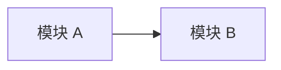
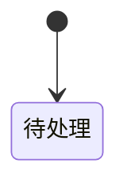
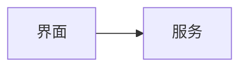

# 产物模板

> 原子技能的推荐产物模板。模板是结构约束，不是自动编排契约。

每个产物都必须包含文末 `Metadata`，日期格式为 `YYYY-MM-DD`。`Scope` 取 `requirement` 或 `module`；模块级产物必须填写 `Module`。

占位符约定：

- `{{requirement}}`：需求标识，如 `user-login-refactor`。
- `{{scope}}`：`requirement` 或 `module`。
- `{{scope-target}}`：需求级写 `all`，模块级写模块名。
- `{{module|-}}`：模块级写模块名，需求级写 `-`。
- `{{branch|-}}`：当前有效 git 分支；非 git 仓库或主干/release 分支写 `-`。
- `{{YYYY-MM-DD}}`：当前本地日期。

## 需求分析

````markdown
# 需求分析：{{requirement}}

## 摘要
- 结论：{{clarify-first | hot-module-split | hot-pre-analysis | hot-use-cases | hot-spec}}
- 规模：{{小 | 中 | 大}}
- 清晰度：{{清 | 有澄清点 | 阻断}}
- 是否阻断：{{是/否}}

## 来源
- 类型：{{对话 | 本地文件 | PRD | 工单 | 缺陷报告}}
- 定位：{{路径 / 工单 ID / 对话}}
- 核心诉求：{{一句话短引用或精确转述}}

## 目标
- {{目标 / 动机}}

## 范围
- 范围内：{{条目}}
- 范围外：{{条目}}

## 约束 / 假设
- 约束：{{条目}}
- 假设：{{条目}}

## 关键术语
| 术语 | 含义 | 置信度 |
|---|---|---|

## 待澄清问题 / 歧义
| 问题 | 是否阻断 | 严重级别 | 未回答时默认处理 |
|---|---|---|---|

## 建议下一步
- {{建议下一步}}
- 原因：{{一句话}}

## Metadata

- Requirement: {{requirement}}
- Scope: requirement
- Module: -
- Branch: {{branch|-}}
- Skill: hot-requirement-analysis
- Created: {{YYYY-MM-DD}}
- Updated: {{YYYY-MM-DD}}
````

## 前置分析

````markdown
# 前置分析：{{requirement}} / {{scope-target}}

## 摘要
- 当前结论：{{一句话}}
- 相关区域：{{路径}}
- 主要风险：{{主要风险}}

## 当前状态
| 主题 | 事实 | 来源 |
|---|---|---|

## 代码结构


## 数据流 / 依赖
| 流向或依赖 | 说明 | 来源 |
|---|---|---|

## 可复用点
| 可复用点 | 位置 | 用法 |
|---|---|---|

## 风险 / 未知项
| 风险 | 影响 | 建议处理 |
|---|---|---|

## Metadata

- Requirement: {{requirement}}
- Scope: {{scope}}
- Module: {{module|-}}
- Branch: {{branch|-}}
- Skill: hot-pre-analysis
- Created: {{YYYY-MM-DD}}
- Updated: {{YYYY-MM-DD}}
````

## 模块拆分

````markdown
# 模块拆分：{{requirement}}

## 摘要
| 模块 | 职责 | 顺序 |
|---|---|---|

## 依赖图


## 模块
### {{module}}
- 职责：{{一句话}}
- 输入：{{输入}}
- 输出：{{输出}}
- 不做：{{非目标}}
- 依赖：{{依赖}}

## 边界决策
| 决策 | 归属 | 原因 |
|---|---|---|

## 建议顺序
1. {{module}}

## Metadata

- Requirement: {{requirement}}
- Scope: requirement
- Module: -
- Branch: {{branch|-}}
- Skill: hot-module-split
- Created: {{YYYY-MM-DD}}
- Updated: {{YYYY-MM-DD}}
````

## 用例

````markdown
# 用例：{{requirement}} / {{scope-target}}

## 摘要
- 主流程：{{数量}}
- 分支/异常：{{数量}}
- 非目标：{{数量}}

## 主流程
| 场景 | 触发 | 期望结果 |
|---|---|---|

## 分支 / 边界场景
| 场景 | 条件 | 期望结果 |
|---|---|---|

## 失败 / 竞态场景
| 场景 | 风险 | 期望处理 |
|---|---|---|

## 非目标
- {{条目}}

## 验收场景
- [ ] {{场景}}

## Metadata

- Requirement: {{requirement}}
- Scope: {{scope}}
- Module: {{module|-}}
- Branch: {{branch|-}}
- Skill: hot-use-cases
- Created: {{YYYY-MM-DD}}
- Updated: {{YYYY-MM-DD}}
````

## 规格

````markdown
# 规格：{{requirement}} / {{scope-target}}

## 摘要
{{行为契约一句话}}

## 行为契约
| 场景 | 系统必须做到 | 验收口径 |
|---|---|---|

## 业务规则
| 规则 | 说明 | 例外 |
|---|---|---|

## 状态 / 流程


## 边界
- 范围内：{{条目}}
- 范围外：{{条目}}

## 验证
- 默认验证：跑应用 / 走查场景 / 已有测试
- 需单测：否

## Metadata

- Requirement: {{requirement}}
- Scope: {{scope}}
- Module: {{module|-}}
- Branch: {{branch|-}}
- Skill: hot-spec
- Created: {{YYYY-MM-DD}}
- Updated: {{YYYY-MM-DD}}
````

## 计划

````markdown
# 计划：{{requirement}} / {{scope-target}}

## 摘要
{{技术落地方案一句话}}

## 架构


## 文件 / 职责
| 文件或目录 | 操作 | 职责 | 关联规格 |
|---|---|---|---|

## 组件 / 钩子 / 服务
| 单元 | 职责 | 依赖 | 导出 |
|---|---|---|---|

## 状态与数据流
| 数据 | 来源 | 去向 | 竞态处理 |
|---|---|---|---|

## 交互 / 基础设施
| 需求 | 方案 | 原因 |
|---|---|---|

## 注释 / 文档注释
| 位置 | 要求 |
|---|---|

## 验证计划
| 场景 | 验证方式 | 命令或走查 |
|---|---|---|

## Metadata

- Requirement: {{requirement}}
- Scope: {{scope}}
- Module: {{module|-}}
- Branch: {{branch|-}}
- Skill: hot-plan
- Created: {{YYYY-MM-DD}}
- Updated: {{YYYY-MM-DD}}
````

## 计划评审

````markdown
# 计划评审：{{requirement}} / {{scope-target}}

## 结论
**结论：** ✅ 通过 / ⚠️ 有条件通过 / ❌ 需修改

## 问题
| 严重级别 | 问题 | 依据 | 建议 |
|---|---|---|---|

## 覆盖情况
| 来源 | 覆盖情况 |
|---|---|

## 待澄清问题
- {{问题}}

## Metadata

- Requirement: {{requirement}}
- Scope: {{scope}}
- Module: {{module|-}}
- Branch: {{branch|-}}
- Skill: hot-plan-review
- Created: {{YYYY-MM-DD}}
- Updated: {{YYYY-MM-DD}}
````

## 检查

````markdown
# 检查：{{requirement}} / {{scope-target}}

## 结论
**结论：** ✅ 通过 / ⚠️ 有条件通过 / ❌ 未通过

## 证据
| 对照项 | 结果 | 证据 |
|---|---|---|

## 场景走查
| 场景 | 结果 | 备注 |
|---|---|---|

## 缺口
| 缺口 | 影响 | 建议 |
|---|---|---|

## 变更摘要
| 文件 | 改动 | 对应规格/场景 |
|---|---|---|

## Metadata

- Requirement: {{requirement}}
- Scope: {{scope}}
- Module: {{module|-}}
- Branch: {{branch|-}}
- Skill: hot-check
- Created: {{YYYY-MM-DD}}
- Updated: {{YYYY-MM-DD}}
````
